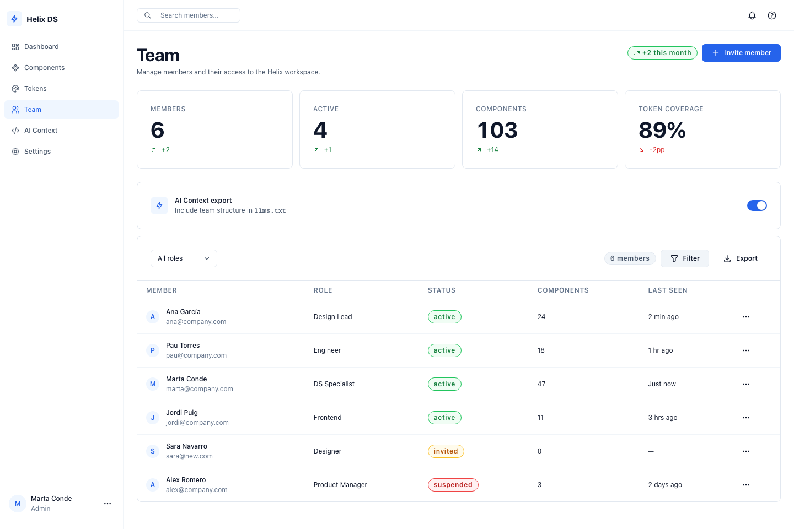
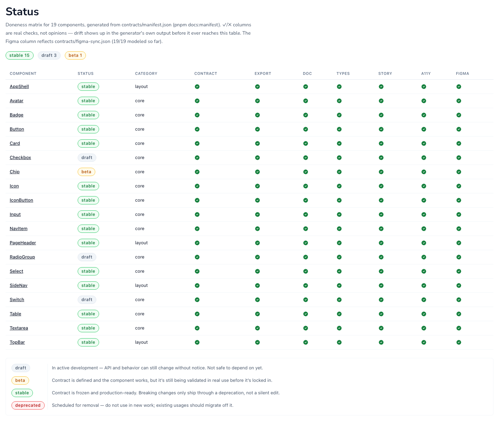

<div align="center">

# ⚡ Helix DS

**The design system an AI agent can use without guessing.**

Explicit per-component contracts, script-verified tokens, and a canonical prop vocabulary — built so humans *and* agents generate the same consistent UI on the first try.

<!-- helix:badge-components:start -->

<!-- helix:badge-components:end -->


[](LICENSE)

<br>



<sub>Everything in this screenshot is Helix: <code>AppShell</code>, <code>SideNav</code>, <code>StatCard</code>, <code>Table</code>, <code>Badge</code>, <code>Switch</code> — zero hand-written layout <code>&lt;div&gt;</code>s.</sub>

</div>

---

## What this is

Helix is a design system built directly on **native HTML elements** — no primitive kit underneath — plus Tailwind CSS v4 and Tabler Icons. [Why, in ADR-001](docs/ADR/ADR-001-primitive-foundation.md). Every component ships with:

- A **contract** (`contracts/components/{Name}.json`) that defines props, variants, and rules before a single line of implementation exists.
- **Tokens** in DTCG format (`--helix-*`), automatically checked against WCAG AA contrast and semantic naming.
- **Evals**: real code-generation prompts run against an LLM, to verify the system itself is interpretable by an agent — not just by a person reading Storybook.

## Getting started

Helix isn't published to npm yet — `packages/*` are `private: true` while the component API stabilizes. Today, using it means working from a clone:

```bash
git clone https://github.com/MartaCondeDesign/helix-ds.git
cd helix-ds
pnpm install
pnpm sb          # browse every component in Storybook → http://localhost:6006
```

Building an app inside this same pnpm workspace? Add Helix as a workspace dependency:

```json
// your-app/package.json
"dependencies": {
  "@helix-ds/core": "workspace:*",
  "@helix-ds/tokens": "workspace:*"
}
```

```tsx
// app/layout.tsx or main.tsx
import '@helix-ds/tokens/helix.css';   // CSS custom properties
import '@helix-ds/core/globals.css';   // Tailwind base + component styles
```

To get an AI agent (Claude, Cursor, Copilot...) working in that app up to speed on Helix's rules from the start:

```bash
pnpm setup:ai <path-to-your-app>
```

Copies `AGENTS.md` into your project (never overwriting one you've hand-edited — it flags the conflict instead of clobbering it) and drops a pointer file for `.cursor/` or `.github/` if those folders already exist. Full detail in [AGENTS.md](AGENTS.md).

## Everything it includes

| | |
|---|---|
| 🧩 **<!--helix:count-->19<!--/helix:count--> components** | <!--helix:core-count-->15<!--/helix:core-count--> content components (Button, Input, Select, Badge, Checkbox, Chip, RadioGroup, Switch, Textarea, Card, Avatar, IconButton, Table...) + <!--helix:layout-count-->4<!--/helix:layout-count--> layout components (AppShell, PageHeader, SideNav, TopBar) |
| 🎨 **DTCG tokens** | `tokens.json` → CSS variables + TS constants, with documented, audited exceptions (`pnpm docs:token-exceptions`) |
| 📐 **No-`<div>` layout** | Every page composition goes through a layout component — never hand-written `display:flex` |
| 📄 **Contract before code** | Every new component starts as a `.json` in `contracts/`; Figma is reference only, the contract wins |
| ♿ **Verified contrast** | Every text/icon-on-fill color pair is checked against WCAG 2.2 AA, in both light and dark |
| 🤖 **AI-ready by default** | `AGENTS.md`, `llms.txt`, contracts, and `.ai/maps/` — an agent can generate correct UI without exploring the codebase first |
| ✅ **Script-verified, not eyeballed** | `verify:contract`, `verify:props`, `verify:tokens`, `verify:icons` run locally before anything is considered done |

## Component status

<div align="center">



</div>

<sub>This table is Storybook's <code>Status</code> page (`pnpm sb`), rendered straight from `contracts/manifest.json`. Every ✓ is a real check — contract exists, exported, documented, typed, has a story, a11y complete, modeled in Figma — not someone's opinion of "done."</sub>

## Commands (for working on Helix itself)

```bash
pnpm install
pnpm sb                    # Storybook → http://localhost:6006
pnpm contract <Name>        # scaffold a new component contract
pnpm verify:contract        # validate contracts vs implementation
pnpm verify:props           # prop names vs .ai/maps/prop-map.md
pnpm verify:tokens          # token naming
pnpm verify:icons           # every Tabler icon goes through the Icon component
pnpm token:add              # add a new token
pnpm docs:manifest          # regenerate contracts/manifest.json
pnpm docs:changelog         # regenerate the changelog shown in Storybook
pnpm eval:run               # LLM code-generation evals
```

## Repo structure

- **`packages/tokens`** — DTCG tokens compiled to CSS and TS. [ADR-002](docs/ADR/ADR-002-token-strategy.md)
- **`packages/core`** — the <!--helix:count-->19<!--/helix:count--> React components.
- **`packages/storybook-addon-tokens`** — Storybook addon for inspecting tokens.
- **`apps/storybook`** — stories per component and per pattern.
- **`contracts/`** — one `.json` per component; `manifest.json` is the generated index of all of them.
- **`.ai/`** — prop vocabulary, design patterns, and skills for agents (Figma, tokens, icons).
- **`docs/ADR/`** — architecture decisions.
- **`evals/`** — prompts and outputs from automated evaluation.
- **`llms.txt`** — index for an LLM to load system context quickly.

## Critical rules (summary)

1. Never `<div>` for layout — use the components in `packages/core/src/layout/`.
2. Never render a Tabler icon directly — always go through the `Icon` component.
3. Color and border-radius: always a `--helix-*` token, no exceptions.
4. New UI with no native HTML equivalent → needs an ADR before implementation.
5. Canonical prop vocabulary lives in `.ai/maps/prop-map.md`; synonyms aren't allowed.
6. New component → contract first, at `contracts/components/{Name}.json`, then the code.

Full detail in [CLAUDE.md](CLAUDE.md) — to contribute to Helix itself, see [contributor-ai/CONTRIBUTOR.md](contributor-ai/CONTRIBUTOR.md).

## Security

Found a vulnerability? Please don't open a public issue — see [SECURITY.md](SECURITY.md) for how to report it privately.

## License

MIT — see [LICENSE](LICENSE) for details.

---

<div align="center">

Built by **[Marta Conde](https://martaconde.com)** — [LinkedIn](https://www.linkedin.com/in/martacondedesign/) · [YouTube](https://www.youtube.com/@martacondedesign) · [martaconde.com](https://martaconde.com)

</div>

<!-- Component counts above (marked with helix:* comments) are generated by `pnpm docs:readme` from contracts/manifest.json — don't hand-edit the numbers, edit the surrounding prose freely. -->

